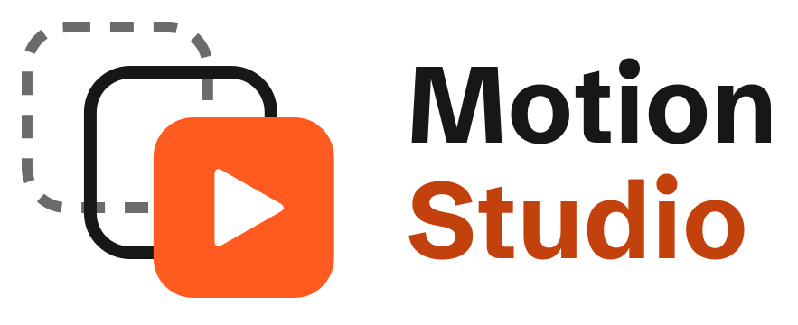
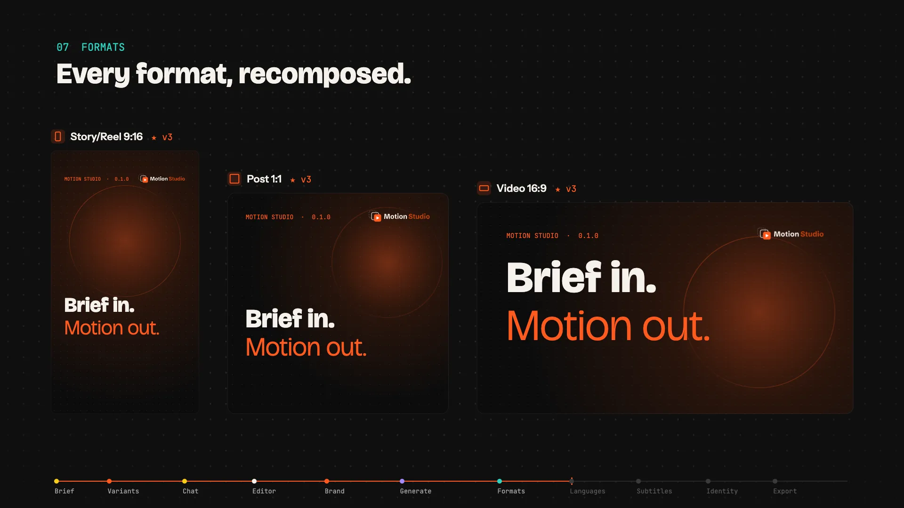

<p align="center">
  <picture>
    <source media="(prefers-color-scheme: dark)" srcset="docs/assets/logo-dark.svg">
    
  </picture>
</p>

# Motion Studio

🇬🇧 [English](README.md)

<p align="center">
  <a href="https://aleloca.github.io/motion-studio/#final-cut"></a><br>
  <a href="https://aleloca.github.io/motion-studio/#final-cut">Guarda il video di lancio</a>
</p>

App locale e open-source per creare video in motion graphics e immagini usando il tuo agente di coding (inizialmente **Claude Code**). Descrivi cosa vuoi, scegli canali e formati: l'agente produce una ricomposizione dedicata per ogni formato. Tutto resta sul tuo computer: i progetti sono cartelle con file JSON/Markdown versionate con git.

<!-- screenshot: aggiungere -->

> Il design completo è in `docs/superpowers/specs/`. Guide per chi sviluppa (in inglese): [CONTRIBUTING.md](CONTRIBUTING.md), [contratto di output](docs/output-contract.md), [provider](docs/providers.md), [backend dell'agente](docs/agent-backends.md).

## Lingua
Motion Studio è disponibile in inglese e in italiano. Al primo avvio usa la lingua del sistema: la prima delle tue lingue preferite supportata da Motion Studio, altrimenti l'inglese. Si cambia in **Impostazioni → Lingua** (Sistema / English / Italiano): l'interfaccia, i menu dell'app desktop e i messaggi del launcher da terminale cambiano lingua, e l'agente risponde e scrive i testi destinati a te nella lingua scelta. Quando l'app desktop si collega a un Motion Studio già in esecuzione, il suo menu nativo resta nella lingua con cui è partito; l'interfaccia segue il cambio subito. Per aggiungere un'altra lingua vedi [CONTRIBUTING.md](CONTRIBUTING.md#adding-a-language) (in inglese).

I testi salvati in passato (problemi di validazione di una versione, messaggi della conversazione, linee guida del brand) non vengono tradotti; solo i testi nuovi usano la lingua corrente.

## Installazione

**App desktop (Electron).** Scarica l'installer dalla pagina [Releases](https://github.com/Aleloca/motion-studio/releases) di GitHub del progetto:
- macOS: il `.dmg` per Apple Silicon (`arm64`) o Intel (`x64`), firmato e notarizzato; trascina Motion Studio in Applicazioni. Gli aggiornamenti vengono controllati all'avvio e installati al riavvio.
- Windows: l'installer `.exe`. Non è ancora firmato: la prima volta SmartScreen mostra "Windows ha protetto il PC": clicca **Ulteriori informazioni**, poi **Esegui comunque**.
- Linux: l'`.AppImage`: rendila eseguibile (`chmod +x Motion*.AppImage`) e avviala.

**Da npm.** `npx @motion-studio/cli` (Node 22 o successivo; installato globalmente il comando si chiama `motion-studio`): avvia Motion Studio e lo apre nel browser.

**Dai sorgenti.**
```bash
pnpm install
pnpm motion-studio        # build + avvio su http://127.0.0.1:4317 e apertura del browser
```

Opzioni del launcher (dopo il nome dello script, es. `pnpm motion-studio --port 5000 --no-open`):
- `--port <n>` — porta del server locale (1–65535, predefinita 4317).
- `--no-open` — non aprire il browser (se l'apertura non riesce, il launcher stampa l'indirizzo da aprire a mano).
- `--print-url` — stampa l'indirizzo del Motion Studio già avviato, senza avviarne un altro (utile se hai chiuso la scheda).

L'indirizzo stampato all'avvio contiene un codice di accesso (`#t=…`): apri Motion Studio da quel link. Il browser lo ricorda; se l'interfaccia chiede di riaprirla dal link del terminale, usa `--print-url`. L'app desktop apre da sola la propria finestra.

Per ogni cartella di configurazione gira un solo Motion Studio: se è già avviato (dal terminale o come app desktop), `motion-studio` stampa `Motion Studio è già avviato: <indirizzo>`, lo apre nel browser (salvo `--no-open`) e termina, e l'app desktop apre quell'indirizzo invece di avviarne un altro (se quel Motion Studio si chiude, l'app propone di riavviarsi).

## Requisiti
- [Claude Code](https://docs.claude.com/claude-code) installato e autenticato (`claude auth login`)
- Git
- FFmpeg (serve per renderizzare le composizioni in video; le immagini fisse non ne hanno bisogno; senza, le creatività vecchie risultano "non verificate")
- Solo per la CLI (`npx`): Google Chrome o Chromium, che renderizza le composizioni. Se manca, **Impostazioni → System check** propone di scaricare Chrome for Testing nella cartella dati di Motion Studio, solo dopo averne mostrato la dimensione e con il tuo consenso. L'app desktop renderizza con il proprio Chromium.
- Node.js 22+ per `npx` e per i sorgenti (non serve per l'app desktop)

## Come funziona
1. In un progetto apri **Creatività → + Nuova creatività**, descrivi cosa vuoi, scegli canali e formati e premi **Genera**.
2. L'agente lavora in `creatives/<data-titolo>/work/` e consegna in `outputs/vN/compositions/<formato>/` una **composizione** per formato: un `composition.json` (scene, tracce, testi, forme, immagini, video, audio, animazioni, livelli HTML facoltativi) e gli `assets/` che usa ([contratto completo](docs/output-contract.md)). L'agente non renderizza mai i media finali e non installa renderer.
3. Motion Studio controlla ogni composizione (schema, file, durata rispetto al brief): se qualcosa non torna chiede all'agente di correggere, fino a 3 tentativi in totale; poi salva la versione, anche se incompleta. Poi crea una storyboard (un piccolo fotogramma per scena) per ogni formato.
4. Le tavole mostrano le storyboard e riproducono un'**anteprima dal vivo** della composizione: non serve aspettare un render. Una versione nasce "Not rendered".
5. **Esporta** renderizza ciò che serve sul tuo computer, fuori dalla sandbox dell'agente (non c'è un tasto Render a parte; anche l'agente può renderizzare una versione): un mp4 (H.264, BT.709) per i video, un file immagine per le fisse (un png se il formato lo prevede, altrimenti un jpg o webp tra quelli ammessi). Il render di una versione è alla dimensione del formato e in qualità **Alta** (libx264, circa 8 Mbps a 1080p30); registra qualità, dimensione e l'encoder usato. Un render fatto prima della scelta della qualità vale come Standard e un export predefinito lo rifà. Un render non blocca mai l'agente: i render aspettano in una coda propria, uno alla volta. Una modifica successiva crea una nuova versione, e il render di un'altra versione non viene mai toccato; rifare il render della stessa versione ne sostituisce il file.
6. Ogni versione è un commit git del progetto. Dalla pagina della creatività puoi aprire un formato, aggiungere commenti su un punto/istante, chiedere modifiche, confrontare versioni e ripartire da una versione precedente. Una creatività fatta prima delle composizioni tiene i suoi video; alla modifica successiva l'agente la converte in composizione (la chat avvisa che quel turno costa più token).

### Brief con l'agente

**Nuova creatività** si apre su **Compila tu**, il modulo di sempre. **Con l'agente** (barra in alto), oppure **Fallo compilare all'agente** nel riquadro dell'obiettivo, apre a sinistra del modulo una chat con un agente in sola lettura; il testo dell'obiettivo, se c'è, passa nel campo del messaggio (non viene inviato). Il **+** sotto il messaggio collega cartelle di codice del tuo Mac (in sola lettura, con la scansione dei segreti dell'analisi del brand), sceglie asset dagli Asset o carica file dal Mac (finiscono anche nella libreria); gli elementi aggiunti sono spille nel campo del messaggio e, una volta inviati, nella riga sotto ("2 cartelle · 3 asset"), dove ognuno si può togliere. L'agente li legge e compila il vero modulo: obiettivo, messaggio chiave, durata, asset, cartelle di codice con una nota, note, formati (solo id del catalogo) e il numero di varianti se le chiedi. Un campo scritto dall'agente porta il segno **Agente** e si illumina una volta; un campo che cambi a mano è tuo e l'agente non lo sovrascrive, a meno che tu non gli chieda in chat di riscriverlo. Non si crea nulla finché non premi **Genera** (o **Salva bozza**), spenti mentre l'agente lavora; poi la chat diventa l'inizio della chat della nuova creatività, e il primo turno della creatività riprende la memoria dell'agente del brief. Una sessione del brief per progetto: uscendo dalla pagina resta, e Nuova creatività propone poi **Riprendi la sessione del brief** o **Inizia da capo**.

### Analisi dei video

Un video che entra in un brief (il modulo del brief, la chat dell'agente del brief, un asset aggiunto al brief di una creatività) viene analizzato una volta: Motion Studio estrae con ffmpeg i fotogrammi a ogni taglio (e uno ogni 10 s nelle scene statiche lunghe) e l'audio, trascrive il parlato se lo permetti, e un agente in sola lettura descrive i fotogrammi. Il risultato è un file di testo accanto al video, `assets/.analysis/<video>.md`: un riepilogo, una sola timeline con cosa si vede, il testo a schermo e cosa si dice con i suoi tempi, i momenti riutilizzabili, l'aspetto (colori, tipografia, inquadratura, audio), la trascrizione e i tag. L'agente delle creatività e quello del brief lo leggono prima di aprire il video. Il file porta lo sha256 del video: lo stesso contenuto non si analizza mai due volte, un video cambiato si analizza di nuovo. I video oltre 20 minuti chiedono prima (**Analizza tutto** o **Analizza a densità ridotta**, con fotogrammi e token stimati).

- **Asset**: i dettagli di un video hanno una sezione **Analisi**: lo stato (Non analizzato, In corso, Pronta, Non aggiornata, Errore), il riepilogo, le scene e la trascrizione (un clic su una riga porta il player a quel momento), il testo a schermo e i tag, con **Analizza** / **Rianalizza** e **Modifica** (il testo sotto l'intestazione; un'analisi modificata chiede prima di essere sovrascritta). Un video analizzato ha un piccolo segno sulla scheda; l'avanzamento è anche nel centro attività.
- **Genera** mentre un'analisi è in corso: il primo turno della creatività la aspetta, con "Analisi del video in corso (clip.mp4)… · Salta" in chat; **Salta** fa partire il turno senza. Un'analisi fallita non blocca mai una creatività.
- **La trascrizione è facoltativa.** Quando un video ha del parlato e non c'è un metodo, compare una scelta (un dialogo nel modulo e negli Asset, una scheda nella chat dell'agente del brief): **Installa Whisper** (gratis, sul tuo Mac, con la dimensione del download), **Trascrivi con OpenAI** o **con ElevenLabs** (a pagamento, con il costo stimato, l'audio lascia il Mac; solo con una chiave salvata), **Continua senza trascrizione**, e **Ricorda la scelta**. Nulla si scarica o si paga senza quel clic.
- **Impostazioni → Trascrizione video**: il metodo (Chiedi ogni volta, Whisper sul Mac, OpenAI, ElevenLabs, Mai), il modello di Whisper (Small, circa 490 MB, o Large v3 Turbo, circa 1,6 GB) con **Installa** e **Rimuovi**, e **Usa un Whisper già installato**: i Whisper trovati sul Mac (PATH e cartelle di Homebrew; **Cerca di nuovo**), oppure un programma (e per whisper.cpp un file del modello) scelto con **Scegli…**, provato su un secondo di audio prima di salvarlo ("Whisper trovato: motore, versione, modello, Metal/GPU"). Funzionano whisper.cpp, openai-whisper e faster-whisper; quelli Python scaricano da soli i loro modelli al primo uso.
- **Whisper nell'app**: l'app per macOS include `whisper-cli` di whisper.cpp (con Metal) e scarica solo il modello. L'app in sviluppo, il pacchetto npm, Windows e Linux usano un Whisper installato: su Mac `brew install whisper-cpp`, poi **Installa** un modello nelle Impostazioni (o scegli un `ggml-*.bin` che hai già); oppure `pip install openai-whisper` / `faster-whisper`.

### Archiviare ed eliminare una creatività

Dal menu **…** di una creatività (nella sua pagina o sulla sua scheda tra le creatività del progetto) puoi **Archiviarla**: esce dalle liste e dalla ricerca e resta nel progetto, sotto **Archiviate** nella pagina delle creatività, dove **Ripristina** la riporta indietro. **Elimina** chiede conferma e sposta la cartella della creatività nel Cestino del sistema (recuperabile finché non lo svuoti); la rimozione viene registrata nel progetto, quindi la cronologia git conserva tutte le versioni. Nessuna delle due è possibile mentre è in corso una richiesta, una richiesta in coda o un render della creatività. Dalla pagina di un gruppo entrambe agiscono su tutte le varianti; una variante B–E si può archiviare o eliminare da sola dal menu della sua riga, e lascia il gruppo. Nella versione da riga di comando l'eliminazione usa `~/.Trash` su macOS (solo per progetti sullo stesso disco) e il Cestino freedesktop su Linux; altrove è rifiutata. L'agente non archivia né elimina mai.

### Parlare con l'agente mentre lavora
Il campo di scrittura resta attivo mentre l'agente lavora.
- **Queue for after (in coda per dopo).** Un messaggio inviato durante un turno entra nella coda delle richieste e parte come richiesta successiva. Parte da solo solo dopo un turno che ha salvato una versione; dopo un errore, uno Stop, un annullamento o un riavvio dell’app aspetta **Run next** (dopo un riavvio ogni richiesta in coda ha bisogno del suo). La console non ha coda: un messaggio a un turno di console in corso va dal vivo oppure non va. Puoi modificare, togliere e riordinare le richieste in coda.
- **Stop** ferma subito il turno e annulla le approvazioni aperte, così dopo non si spende nulla. La richiesta successiva riprende la sessione fermata come ramo (fork), quindi l'agente sa cosa è rimasto a metà.
- **Stop and redirect** ferma il passo in corso e continua lo stesso job con il tuo nuovo testo.
- **Messaggi dal vivo e interruzione** (inviati all'agente in esecuzione senza riavvio) sono **attivi di default con Claude Code 2.1.301 e successivi**, la versione provata con un Claude Code reale il 2026-10-16 (`docs/superpowers/notes/2026-10-16-stream-input-probe.md`). Le versioni precedenti o sconosciute restano sui ripieghi: il messaggio aspetta e parte come richiesta successiva, e Ferma e reindirizza ferma l'agente e riprende la sessione. L'agente legge un messaggio dal vivo appena finisce il passo in corso; il messaggio mostra "Inviato" quando è scritto e "Consegnato" solo quando Claude Code mostra di averlo preso. Per spegnerli imposta `agentLiveInput` o `agentInterrupt` a `false` nel `.studio/settings.json` dello spazio di lavoro (non c'è un interruttore nell'interfaccia). Il Doctor e `GET /api/agent/capabilities` dicono quale percorso è attivo.

### L'agente agisce sull'app
In un turno di una creatività l'agente può fare nell'app ciò che faresti tu, **senza scheda di conferma**; la chat mostra ogni azione come riga marcata *Azione dell'agente* (per esempio "Durata del brief: 6 s → 60 s", "Nuova variante C: …", "Render avviato: v2 · YouTube 16:9"). Chiediglielo a parole ("fai anche un 9:16", "aggiungi una variante più ironica") e usa i suoi strumenti invece di dirti dove cliccare:
- **Brief**: durata, obiettivo, messaggio chiave, note e servizi (`update_brief`). Il brief cambia quando il turno dell'agente finisce (in un gruppo di varianti: il brief del gruppo, subito per le varianti ferme); una durata nuova vale subito per il controllo degli output di quel turno.
- **Formati e lingue**: aggiunge un formato del catalogo (creato in un turno subito dopo, come **Salva e rigenera**), duplica un formato, aggiunge una lingua (tradotta dopo il turno).
- **Varianti**: ne aggiunge una con la sua direzione (avvia un suo turno a pagamento, come **+ Variante**), scarta, ripristina, imposta la ★.
- **Render ed export**: renderizza una versione, o ciò che serve all'export ★. L'export vero e proprio (dove vanno i file) resta tuo.
- **Mai**: archiviare, eliminare, nulla fuori dalla propria creatività, dal gruppo di varianti e dal progetto, impostazioni, chiavi o permessi. I servizi a pagamento (immagini, voce, musica, effetti sonori) mantengono le conferme di costo.
- **Limiti**: 30 azioni per turno; al massimo un turno successivo per i formati nuovi (mai da un turno successivo) e una traduzione per turno; le varianti si fermano alle 5 del gruppo (contano anche le scartate).

Quando la durata del video di una versione è lontana da quella del brief, il tentativo di correzione può aggiornare la durata del brief (se il testo del brief o le tue parole la chiedono chiaramente) o chiedertelo, invece di provare tre volte. Una versione incompleta dice in chat cosa non va e cosa fare, e cambiare la durata del brief ricontrolla subito l'ultima versione incompleta, senza un nuovo turno. Il modulo Nuova creatività avvisa quando il testo del brief indica una durata diversa dal campo ("Il testo dice 60 s, la durata è 6 s · Usa 60 s").

### Consumi e token
Ogni lavoro dell'agente (turno di una creatività, tentativo di correzione, analisi del brand, descrizione degli asset) aggiunge una riga a `<progetto>/.studio/usage.jsonl` con i token riportati da Claude Code per quel turno e, quando è noto, il costo ai prezzi di listino delle API. Il file si scrive solo in coda ed è protetto dall'agente.
- **Prima i token, poi il costo.** La cifra mostrata è token di input + output + scrittura in cache; le letture dalla cache stanno solo nei dettagli. Con un abbonamento Claude il costo compare come "ai prezzi API sarebbe circa …", perché il consumo conta sul piano.
- **Dove si vede:** contatore dal vivo sul lavoro in corso, totale di oggi nella barra in alto (apre **Impostazioni → Usage**), centro attività (per lavoro, più "Today · N tokens"), scheda di ogni versione nella conversazione, ogni analisi del brand, il brief della creatività e **Impostazioni → Usage** (ultimi 7 giorni, per progetto e per tipo di lavoro). Il modulo della nuova creatività stima un intervallo dalle tue prime generazioni passate.
- **Sessioni riprese:** per una sessione ripresa Claude Code riporta il costo cumulativo, quindi ogni riga salva la differenza dal turno precedente della stessa sessione; se non si può calcolare, il costo resta vuoto e marcato come stimato.
- **Niente numeri inventati:** i lavori precedenti a questa funzione non hanno cifre ("Tracked since …") e i valori mancanti mostrano "—" o vengono nascosti.
- **File pesanti:** un video con bitrate oltre 1,5 volte un obiettivo ragionevole per la sua misura (per esempio circa 4 Mbps per un reel 1080×1920 a 30 fps) riceve il chip "large" con peso, bitrate e obiettivo. È solo un avviso: non fa mai fallire l'output.

### Esporta
Dalla pagina della creatività, **Esporta** copia la versione ★ di ogni formato in una cartella a tua scelta (nell'app desktop c'è anche **Scegli…**). Ogni riga mostra il nome finale del file, "★ vN" (e "vM più recente" se esiste una versione più nuova) e "segue …" per un formato che ne segue un altro: si esporta come file proprio dalla versione ★ del suo principale. I nomi vengono da uno schema con le variabili `{title} {channel} {format} {ratio} {v} {date}` (predefinito `{title}-{format}-v{v}`, es. `lancio-instagram-reel-9x16-v2.mp4`); ogni valore diventa uno slug, gli altri caratteri diventano `-`, il nome è limitato a 120 caratteri prima dell'estensione, `{date}` è il giorno mostrato nella finestra (`AAAA-MM-GG`), i nomi riservati di Windows come `CON` o `NUL` ricevono un `_` e le variabili sconosciute vengono omesse (la finestra le segnala). La finestra mostra l'anteprima dei nomi mentre scrivi e **Salva come predefinito** salva lo schema per il workspace. Se due formati avrebbero lo stesso nome (senza distinguere maiuscole e minuscole) l'export viene rifiutato: aggiungi `{format}`. Non sovrascrive mai nulla (se il nome esiste aggiunge `-2`, `-3`…) e rifiuta le destinazioni dentro il workspace di Motion Studio. Una ★ il cui file manca, è un link simbolico o un hard link non si può esportare: la finestra la disattiva e l'export la rifiuta prima di copiare qualsiasi file. Una ★ in forma di composizione non ancora renderizzata (o con un render non aggiornato) viene prima renderizzata e poi copiata. L'export gira in background: la finestra si può chiudere in ogni momento, il tasto **Esporta** della barra ne mostra l'avanzamento ("Esportazione 26%"), il centro attività lo elenca con **Annulla**, e quando i file sono nella cartella compare un messaggio con **Mostra nel Finder** (anche una notifica se l'app è in background). **Annulla export** lo ferma, insieme ai render che ha avviato. **Mostra nel Finder** seleziona il file quando è uno solo, altrimenti apre la cartella. **Risoluzione** (la dimensione del formato, o da 480p a 2160p con le proporzioni del formato, sul lato corto) e **Qualità** (Standard: la codifica di prima, VideoToolbox ammesso; Alta, la predefinita: libx264 CRF 18; Massima: libx264 CRF 16 da fotogrammi senza perdita) valgono per i video fatti da una composizione; una scelta diversa da dimensione del formato e Alta si renderizza solo per quell'export e non sostituisce mai il render della versione. Immagini, formati di identità e formati store mantengono la loro dimensione; con altre lingue i video restano alla dimensione del formato e in Alta. L'ultima scelta viene ricordata.

### Aggiungere formati
Se in una creatività già generata aggiungi formati al brief e premi di nuovo **Genera**, Motion Studio chiede all'agente di aggiungere solo le composizioni mancanti, riusando i sorgenti già presenti in `work/` e lo stesso stile della versione precedente. Un formato collegato a un altro (per esempio TikTok che segue il Reel) non richiede l'agente: condivide la composizione e il render del suo principale. In una creatività fatta prima delle composizioni, aggiungere solo formati collegati continua a non richiedere l'agente: sono copie del video del loro principale, come prima. Aggiungere un altro formato, o rigenerare, converte ogni formato in composizione con l'agente; l'editor del brief lo dice prima di **Salva e rigenera**, perché quel turno costa più token.

### Varianti: formati duplicati, lingue, pacchetto store
**Duplicare e riordinare i formati.** Una creatività può contenere lo stesso formato più volte, per esempio due Story o dieci screenshot per lo stesso iPhone. Nella vista di un formato, **Duplicate format** copia la composizione della versione aperta nell'istanza libera successiva (`<formato>@2`, fino a `@20`; la prima istanza tiene l'id nudo del formato, quindi le creatività esistenti non cambiano) e la salva come nuova versione senza agente. Da lì l'istanza si itera da sola: in chat con i chip "Si applica a", oppure nell'editor; le altre istanze restano identiche byte per byte. Ogni istanza può avere un'**etichetta** (fino a 60 caratteri, modificabile nell'editor del brief), altrimenti mostra il nome del formato con "#2". L'editor del brief riordina anche le istanze (trascinamento, oppure Sposta su e Sposta giù) e le rimuove: rimuovere non tocca le versioni salvate. L'ordine è quello di visualizzazione e di export. I nomi di export aggiungono l'istanza (`instagram-post-1x1-2`) quando due file dello stesso formato collidono.

**Lingue.** Nell'editor del brief (**Languages**) scegli la lingua originale e fino a 10 lingue in cui tradurre (scritture latina, cirillica e greca, cinese, giapponese, coreano, hindi, thai e altre; le lingue da destra a sinistra sono elencate ma non ancora supportate). Il pulsante **Languages** della creatività apre il pannello:
- **Translate** avvia un turno di traduzione sulla versione aperta, per le lingue e i formati che spunti. L'agente risponde solo con i testi tradotti (e, per le lingue più lunghe, una scala del testo); non modifica la composizione, quindi posizioni, tempi, colori e immagini restano quelli dell'originale. Motion Studio controlla il risultato e, se un testo non sta nel riquadro, ne chiede uno più corto (fino a 3 tentativi).
- **Opzioni voce**, per lingua: **Translate** (Motion Studio genera la voce tradotta con il servizio di voce scelto nel brief, dopo un'unica conferma per tutto il turno con chiamate, caratteri e servizio; vale "Sempre per questo progetto"), **Keep original** (resta la voce originale) o **Mute**. Senza servizio o chiave di voce restano solo Keep original e Mute.
- **Revisione**: per formato e lingua, una tabella con l'originale, la traduzione modificabile, lo stato (OK, fuori riquadro, superata) e un cursore della dimensione del testo (**fit**, da 70% a 100%). Salvare una traduzione scrive solo la sovrapposizione di quella versione e rilancia i controlli; non crea mai una nuova versione della composizione. Una traduzione che non sta nel riquadro mostra "Outside the box" finché non la accorci o riduci la dimensione.
- **Anteprima**: il player e l'editor hanno un selettore di lingua che mostra la traduzione nell'anteprima dal vivo.
- **Font**: per le scritture che il font originale non disegna (per esempio il giapponese), Motion Studio scarica da Google Fonts il Noto Sans di quella scrittura in `assets/fonts/` e lo aggiunge alle clip di testo di quella lingua.
- **Versioni successive**: una versione successiva porta le traduzioni il cui testo di origine non è cambiato; le altre sono segnate **Outdated** e **Translate** rifà solo ciò che manca o è superato. Un testo superato non si mostra mai come tradotto: anteprima e render usano il testo originale di quella clip e lo segnalano.
- **Render ed export per lingua**: **Render** ed **Esporta** accettano le lingue; i file si chiamano `<formato>.<lingua>.<ext>` (il modello di export riceve `{locale}` quando la creatività ha lingue). Il render di una traduzione con problemi aperti o testi superati chiede conferma ("Render anyway") e lo segna nel manifest.

**Pacchetto App Store.** **Nuova creatività → App store pack** chiede l'app (nome e una riga), gli store (App Store, Google Play o entrambi), i dispositivi, il numero di screenshot con una didascalia ciascuno, un video di anteprima facoltativo e le schermate reali dell'app (immagini dagli Asset, una per screenshot, oppure un esplicito "nessuna schermata"). Crea una creatività normale con un'istanza di formato per screenshot e dispositivo, con etichetta "N · didascalia", e dice all'agente che è una serie: stessa griglia e stile, didascalia in alto, schermata dell'app dentro una cornice generica di dispositivo disegnata in HTML e CSS (nessun artwork né logo Apple o Google). **Export store pack** (nell'intestazione della creatività) scrive `<titolo>-store-pack/` con `AppStore/<dispositivo>/NN-<didascalia>.png`, `AppStore/preview.mp4`, `GooglePlay/<dispositivo>/…` e `feature-graphic.png`, più un `README.txt` con i limiti, l'ordine di caricamento e la nota che Google Play vuole un link YouTube e non un file video (con le lingue c'è un livello per lingua). Prima di scrivere ogni file Motion Studio controlla dimensioni esatte, PNG o JPEG, niente canale alfa (gli screenshot sono appiattiti sullo sfondo) e, per l'anteprima App Store, 15-30 s, 30 fps, H.264 e traccia audio (se la composizione non ne ha, ne aggiunge una silenziosa). Un file che non passa è saltato con il suo motivo; il resto del pacchetto si esporta. I limiti sono stati letti dalle pagine pubbliche di Apple e Google il 2026-10-14. Verificato dal vivo: vedi `docs/superpowers/notes/2026-10-14-phase12-live-checks.md`.

### Varianti creative
Una **variante** è una direzione creativa diversa per lo stesso brief, con tutti i formati. Una creatività può avere da 1 a 5 varianti (A, B, C…); condividono il brief e nell'elenco delle creatività formano un solo gruppo ("N varianti").

**Crearle.** In **Nuova creatività** il campo **Varianti** (da 1 a 5) crea il gruppo. Da 2 in su ogni variante ha una direzione facoltativa (una riga, per esempio "minimale, molto spazio bianco"). Le direzioni che lasci vuote le propone un breve turno dell'agente che non crea file e le rende chiaramente diverse tra loro; le tue hanno sempre la precedenza e si possono modificare dopo (la modifica vale dal turno successivo di quella variante). In seguito ne aggiungi una con **+ Variante** nel menu ⋯ della creatività: parte dal brief o dall'ultima versione di una variante a tua scelta. Al massimo 2 varianti lavorano insieme; le altre aspettano in coda con il motivo scritto.

**Lavorarci.** La chat ha il selettore **Variante · A · B · C · Tutte**. **Tutte** manda la stessa richiesta a ogni variante attiva (i commenti puntati non vanno a Tutte). Con i servizi a pagamento attivi, una sola conferma di costo copre tutto il lotto e le varianti partono solo dopo la tua risposta. Nella tela, **Raggruppa per** passa da formato a variante.

**Scegliere.** La ★ vale tra le varianti: per ogni formato metti la ★ sulla versione che vuoi, da qualsiasi variante. **Selezione finale** elenca ciò che verrà esportato (e ciò che manca); senza ★ vale la prima variante attiva. **Esporta** del gruppo scrive il file ★ di ogni formato, renderizzando prima ciò che serve, con i nomi di sempre. **Esporta questa variante** (nel menu della riga della variante) esporta solo quella.

**Scartare e ripristinare.** **Scarta** toglie una variante dalla scelta (non si può scartare l'ultima attiva, né una che sta lavorando); le sue ★ tornano alla regola predefinita. **Mostra scartate** le elenca in grigio. Una variante scartata è in sola lettura: niente turni, modifiche, traduzioni o render finché non la **Ripristini** (una ★ precedente non torna).

**Identità.** Un logo da zero con più proposte crea varianti: ognuna ha il proprio logo, favicon e icona app, coerenti tra loro. Le proposte delle creatività fatte prima di questa versione restano valide come erano.

**Limiti.** Un gruppo non si può eliminare né rinominare per intero (l'app non ha nemmeno l'eliminazione o la rinomina delle creatività). Le richieste trattenute in attesa della conferma di costo stanno solo in memoria: se l'app si riavvia nel frattempo non si perdono ma non partono, e le avvii con **Avvia la prossima** nella coda. Verificato dal vivo: vedi `docs/superpowers/notes/2026-10-16-phase15-live-checks.md`.

### Modificare una composizione direttamente
Aprire un formato (dalla tela della creatività, con **Apri l’editor** su una tavola, da un link o dal percorso in alto) apre direttamente il suo editor: la pagina del formato è l'editor, senza un'anteprima a parte (i vecchi link `…/edit` aprono la stessa pagina). Un formato che ne segue un altro apre la composizione del suo principale, e l'intestazione dice quali formati la condividono. L'editor ha le scene (o, per un'immagine fissa, i livelli) a sinistra, il palco con l'anteprima dal vivo al centro, la timeline sotto un video, e **Chat** e **Ispettore** come schede a destra: si vede prima la chat, selezionare una clip mostra il suo ispettore, e un commento riporta alla chat. La barra ha ciò che la pagina del formato ha sempre avuto: **Tutti i formati**, il badge ★ del formato con le sue versioni (vedi, ★, confronta), **Versioni**, **Lingue**, **Duplica formato** ed **Esporta** (un render o un export in corso si vede dentro il tasto, alla stessa dimensione). Una versione del formato senza composizione (fatta prima delle composizioni), o un formato ancora senza versioni, mostra invece la sua anteprima.

- **Sola lettura, con il motivo sul palco e nell'ispettore:** una versione precedente (scelta nel badge ★, con **Vedi vN** su una versione nella chat, o con una ★ messa a mano su una versione precedente) si apre nello stesso editor senza poterla modificare, e **Modifica la vN** torna all'ultima, dove le modifiche non salvate ti aspettano ancora; lo stesso per una variante scartata e per una creatività mentre gira un turno dell'agente o un render.
- **Testina:** un clic su una clip della timeline porta la testina al punto cliccato (all'inizio della clip se quel punto ne è fuori), senza avviare né fermare la riproduzione; scegliere una clip in **In questa scena** va al suo inizio quando la testina è altrove. La testina si trascina dalla sua maniglia sul righello, o trascinando in un punto qualsiasi del righello; si muove a fotogrammi interi.

- **Cosa puoi cambiare:**
  - di un testo, contenuto, carattere (uno della composizione, o un carattere del brand kit che ha un file: il file viene aggiunto alla composizione), peso (solo quelli dichiarati per il carattere), dimensione, colore e allineamento;
  - posizione, dimensione, rotazione e opacità: con le maniglie sul palco (con aggancio a guide, area sicura e quadro), con i numeri dell'ispettore, o spostando con Alt+frecce;
  - i tempi: accorciare e spostare le clip sulla timeline (con aggancio, che Alt disattiva), con **Ripple** per spingere le scene successive quando una clip si allunga; l'ordine delle scene, quando ogni clip sta in una sola scena;
  - le animazioni predefinite di entrata e di uscita;
  - un file di immagine, immagine vettoriale, video o audio, sostituito dagli Asset del progetto o caricato lì (un video più corto della clip lo segnala e propone "Adatta la clip al video"); inizio del taglio e volume di un video; volume e dissolvenze di una clip audio;
  - i parametri di un livello HTML;
  - nascondere e bloccare clip e tracce, e silenziare le tracce audio.

  Nuove clip, livelli, animazioni personalizzate, effetti e nuove scene restano all'agente: chiedili in chat.
- **Annulla e ripristina:** ⌘Z e ⇧⌘Z (Ctrl su Windows e Linux), mai mentre scrivi in un campo. Un trascinamento, o una raffica di battute, è un passo solo.
- **Salva:** la pillola "Bozza · N modifiche" offre **Salva come vN** e **Scarta**.
  - Il salvataggio crea una nuova versione normale (`origin: editor`) la cui richiesta è il riepilogo delle modifiche, per esempio "Direct edits: Title text, font Schibsted Grotesk".
  - Non parte nessun agente e non si usano token: il registro dei consumi non riceve righe.
  - Gli altri formati vengono portati; i formati che seguono quello modificato vengono ricontrollati (uno che non può più seguirlo, per esempio perché supera la sua durata massima, viene scollegato e la chat lo dice).
  - I render vengono portati solo per le composizioni invariate, e le storyboard si rifanno.
- **La bozza non si perde per sorpresa:**
  - uscire dall'editor con modifiche non salvate (indietro, un altro formato o versione, un link, un messaggio in chat) chiede "Salva · Scarta · Continua a modificare";
  - ricaricare o chiudere la pagina chiede la conferma del browser (o dell'app, anche per ⌘R e Vista → Ricarica), e un ricaricamento confermato la bozza la perde davvero.
- **Mentre altri lavorano:**
  - mentre gira un turno dell'agente o un render della creatività, il salvataggio non è disponibile (anche il core lo rifiuta);
  - se nel frattempo un turno o un altro salvataggio ha cambiato lo stesso formato, il salvataggio viene rifiutato e la bozza resta; **Riapri sull'ultima versione** la scarta dopo una conferma;
  - un turno su un altro formato non blocca il salvataggio.
- **Commenti per l'agente:** un commento può riguardare un punto del quadro (**Commenta un punto**, la puntina nella barra degli strumenti del palco, o `P`, poi un clic sul punto), una clip (**Commenta la clip**, o `C` con una clip selezionata) o un intervallo di tempo (**Commenta un intervallo**, o `R`, o Maiusc+trascinamento sul righello). Il chip nella chat nomina la clip o l'intervallo, e il prompt dell'agente riporta id e nome della clip o l'intervallo, con un fotogramma (due per un intervallo). Un'animazione personalizzata nell'ispettore ha **Chiedi all’agente**: aggiunge un chip sull'animazione di entrata o di uscita di quella clip e mette il cursore nella chat, così scrivi solo cosa vuoi cambiare.

#### Modificare un SVG
Seleziona una clip `svg` (un logo, una favicon, un'icona d'app, o un'immagine vettoriale dentro un'immagine o un video): la sezione **Contenuto SVG** dell'ispettore modifica l'interno del file, senza un turno dell'agente.

- **Colori:** ogni colore distinto del file (riempimenti, contorni, tappe dei gradienti, `style` e `<style>`), con quante volte è usato. Cambiarne uno sostituisce ogni occorrenza, comunque sia scritta (`#fff`, `white`, `rgb(255,255,255)`); tra i campioni c'è la palette del brand.
- **Testi:** il contenuto di ogni `<text>`, come testo semplice (font, dimensione e posizione restano).
- **Elementi:** i gruppi e le forme, con il nome dal loro `id` o `<title>`, altrimenti dal tipo ("Tracciato 5"). Sceglilo nell'elenco o fai clic sullo stage per evidenziarlo e cambiarne riempimento e contorno; l'occhio lo nasconde o lo mostra.
- Ogni cambio passa dallo stesso controllo stretto degli SVG dei formati di identità, poi la clip punta al nuovo file: annulla e ripeti, la pillola della bozza e **Salva come vN** funzionano come per ogni altra modifica. Un'altra clip che usa lo stesso file tiene l'originale.
- Un SVG che il controllo rifiuta (per esempio senza `viewBox`, o con uno script) dice perché e non si può modificare qui. La versione piccola del logo e il negativo per sfondo scuro sono livelli a parte ("Versione piccola", "Negativo per sfondo scuro"): non cambiano con il logo principale. Dopo il salvataggio di un formato di identità, **Esporta** (o l'agente) rifà PNG e icone.

Una durata cambiata nell'editor è una tua scelta: la versione resta completa anche se è molto diversa da quella del brief, e la barra del formato mostra accanto la durata del brief ("7 s · brief 6 s (modifica diretta)"). Al turno successivo l'agente riceve l'indicazione di mantenere la durata attuale, a meno che tu non ne chieda un'altra; se vuoi che coincidano, aggiorna tu la durata del brief.

Limiti attuali: le build desktop firmate dipendono dai certificati dei maintainer (vedi Rilascio). Su Ubuntu 24.04 e successive l'AppImage può non avviarsi perché il sistema limita i namespace utente non privilegiati (AppArmor, `kernel.apparmor_restrict_unprivileged_userns`), che servono alla sandbox di Chromium: serve un profilo AppArmor per l'app (o, a tuo rischio, disattivare quella restrizione); evita `--no-sandbox`, che toglie l'isolamento della finestra.

## Sicurezza
- **Sandbox dell'agente** (macOS; Linux con `bubblewrap` e `socat`): ogni lavoro dell'agente gira isolato. Può scrivere solo nella cartella del progetto, non può leggere cartelle sensibili (`~/.ssh`, credenziali cloud, portachiavi, configurazione di Motion Studio). La rete dipende dal lavoro: creatività e console usano solo registri di pacchetti, CDN e i domini che aggiungi in **Impostazioni → Rete**; l'analisi brand non ha rete nella sandbox: legge le pagine con `WebFetch` e scarica loghi e font solo con lo strumento `download_file` di Motion Studio, che blocca gli indirizzi privati o locali (controllati sull'IP risolto, a ogni redirect); la descrizione degli asset non ha rete. La sandbox non ripiega sull'esecuzione libera: se non riesce ad avviarsi i comandi non partono, e l'agente non può chiedere di eseguire un comando fuori da essa.
- **File che configurano Motion Studio e l'agente**: in ogni lavoro, con o senza sandbox, l'agente non può modificare `.git/`, `.claude/`, `.studio/`, `CLAUDE.md`, `CLAUDE.local.md` e `.mcp.json` del progetto; Motion Studio esegue git senza hook del progetto.
- **Codebase collegate**: leggibili, mai scrivibili (anche dagli interpreti, grazie alla sandbox); Motion Studio segnala comunque se una codebase git cambia durante un turno.
- **Approvazioni**: tutto ciò che esce dal perimetro (es. installare un programma, scrivere fuori dal progetto) compare come richiesta nella pagina del lavoro e in alto a destra: *Consenti una volta*, *Sempre per questo progetto* (revocabile in Impostazioni del progetto) o *Nega*. "Sempre per questo progetto" è offerto solo per una breve lista di comandi sicuri (`ls`, `mkdir`, `ffprobe`, ottimizzatori di immagini), per cartelle fuori dalle posizioni sensibili e dal workspace, per domini web e per i provider a pagamento; gli altri comandi si approvano una volta per volta. Le regole stanno in `<progetto>/.studio/permissions.json`, protetto dall'agente. Senza risposta entro 10 minuti la richiesta viene negata.
- **Approvazione automatica dei comandi in sandbox** (**Project settings → Agent and approvals**, attiva di default, condivisa da tutti i progetti): un comando shell parte senza chiedere solo se valgono tutte queste condizioni: è un comando `Bash`, il lavoro gira nella sandbox, l'impostazione era attiva all'avvio del lavoro ed è ancora attiva, e l'agente non ha chiesto di eseguirlo fuori dalla sandbox (`dangerouslyDisableSandbox`). Vale per creatività, analisi del brand e descrizione degli asset. È sicura perché un comando approvato resta comunque nella sandbox (verificato dal vivo: anche approvato non scrive fuori dalle cartelle consentite e non raggiunge altri siti). Alle stesse condizioni è approvata anche la lettura di un file nella cartella temporanea per utente di Claude Code (`/tmp/claude-<uid>`, dove possono finire i fotogrammi di controllo dell'agente), mai il resto della cartella temporanea; all'agente si chiede di tenere i fotogrammi in `creatives/<slug>/work/tmp/` dentro il progetto, che non viene mai versionata. Tutto il resto chiede ancora: altri file fuori dal progetto, provider a pagamento, siti nuovi. Ogni comando o lettura approvati così compaiono nella conversazione ("N commands ran automatically in the sandbox · Details", con spiegazione a parole e indicatori di rischio) e, per l'analisi del brand, sulla scheda dell'analisi e nell'elenco Analyses della pagina Brand (dal `log.jsonl` della proposta). L'impostazione **vale per i nuovi lavori**: accenderla non cambia i lavori già in corso; spegnerla vale dalla loro richiesta successiva.
- **Spiegazione dei comandi**: le schede di approvazione e le approvazioni automatiche descrivono il comando a parole con indicatori di rischio (per esempio "Complex command", "Deletes files"), calcolati da Motion Studio sul comando stesso; quando non è sicuro lo dice e valuta il comando almeno medio invece di indovinare. Il motivo scritto dall'agente compare solo come citazione ("The agent says: …") e non sostituisce mai la spiegazione. Il comando completo resta sempre in **Show command**.
- **Chiavi API**: nel portachiavi del sistema (o nelle variabili d'ambiente `OPENAI_API_KEY`, `ELEVENLABS_API_KEY`, `PEXELS_API_KEY`, `UNSPLASH_ACCESS_KEY`); l'agente non le vede mai: le variabili delle chiavi vengono tolte dall'ambiente dell'agente (e del suo server MCP) e gli strumenti MCP chiedono a Motion Studio di chiamare i provider.
- **Azioni dell'agente sull'app** (decisione 917): gli strumenti dell'agente agiscono solo sulla sua creatività, sul suo gruppo di varianti e sul suo progetto, scelti da Motion Studio dal token del lavoro (nessuno strumento prende un percorso, un progetto o una creatività), con input rigidi ricontrollati dal core. Non archiviano, non eliminano e non cambiano impostazioni, chiavi o permessi, e l'export in una cartella resta dell'utente. Un brief può portare l'agente a usarli, cosa che l'utente ha accettato per queste azioni; i limiti sopra impediscono di avviare turni a pagamento senza fine.
- **Costi**: generazioni di immagini, voci fuori campo, effetti sonori e musica chiedono conferma prima di ogni chiamata, sia dall'agente sia da **Genera** negli Asset (disattivabile in Impostazioni con **Chiedi conferma prima di usare provider a pagamento**).
- **Codice di accesso dell'interfaccia**: le API di Motion Studio rispondono solo all'interfaccia aperta dal link del terminale (il codice sta in `ui-token` nella cartella di configurazione). È una difesa contro richieste locali estranee, per esempio pagine web aperte nel browser o programmi che non conoscono il codice; non è una barriera contro un processo dello stesso utente che può leggere la cartella di configurazione.
- **Senza sandbox** (Windows, Linux senza bubblewrap, o isolamento disattivato): Motion Studio usa l'elenco ristretto di comandi della fase precedente e lo segnala nel Doctor e nelle Impostazioni. Senza sandbox i comandi consentiti (node, python, npm/npx, pip, ffmpeg) possono leggere e scrivere ovunque e contattare Motion Studio stesso: usa la sandbox. Possono anche leggere la cartella di configurazione di Motion Studio, compresi il token dell'interfaccia (`ui-token`) e i token del bridge dei lavori in corso in quel momento (`run/*.token`): con il primo un programma può usare tutta l'interfaccia di Motion Studio, approvazioni comprese; con un token del bridge può agire come quel lavoro in corso, nel suo progetto e con i suoi strumenti (una chiamata a pagamento chiede comunque conferma, salvo una regola "Sempre"). Gli strumenti Read, Grep e Glob dell'agente sono negati su quella cartella in ogni modalità, e una richiesta di permesso che nomina un percorso al suo interno viene rifiutata senza chiederti nulla; i comandi non passano da questo controllo. In particolare un interprete avviato dall'agente potrebbe modificare `.studio/permissions.json`: Motion Studio accetta solo regole nei formati che "Sempre per questo progetto" può produrre (comandi sicuri, cartelle fuori dalle posizioni sensibili e dal workspace, domini web, conferme dei provider), quindi l'agente potrebbe concedersi quei permessi o saltare la conferma di costo di un provider, ma non andare oltre quei limiti.
- **Impostazioni dell'area di lavoro senza sandbox**: gli interpreti dell'agente potrebbero anche riscrivere le impostazioni dell'area di lavoro (`.studio/settings.json`). Durante un lavoro senza sandbox Motion Studio usa le impostazioni con cui il lavoro è partito e alla fine rimette il file com'era, con un avviso in chat. Se non ci riesce, tiene i campi che contano per la sicurezza (sandbox, approvazioni, conferma dei costi, opzioni dal vivo, domini extra, modello, lavori in parallelo) al valore più restrittivo tra la sua copia e il file, anche dopo un riavvio, e il Doctor lo segnala finché non salvi le impostazioni. Se non riesce a conservare nemmeno quella copia, i lavori dell'agente senza sandbox sono rifiutati finché non salvi le impostazioni nell'app. È un rilevamento al meglio, non un confine: senza sandbox l'agente lavora con il tuo accesso ai file, comprese le cartelle di Motion Studio.
- **Composizioni (codice scritto dall'agente che gira fuori dalla sandbox).** Una composizione può contenere livelli HTML scritti dall'agente, e Motion Studio la renderizza fuori dalla sandbox, per questo è isolata su quattro livelli:
  - un server locale suo (il composition server), su un'origine diversa dall'interfaccia, raggiungibile solo con un token breve, in sola lettura e limitato a una composizione, che serve solo il runtime e gli `assets/` e i `layers/` di quella composizione (niente link, niente percorsi fuori, controllo contro il DNS rebinding);
  - intestazioni rigide su ogni file: una Content-Security-Policy senza rete (`connect-src 'none'`), ogni livello HTML nel suo frame isolato;
  - nel render, una pagina Chromium con ogni richiesta fuori dal composition server bloccata (intercettazione delle richieste più un proxy "morto"), WebRTC e worker senza uscita, un controllo di tempo e memoria, e l'intero gruppo di processi chiuso in caso di annullamento, timeout o crash. L'app desktop usa finestre Electron nascoste e isolate, ognuna con una sessione in memoria propria; la CLI usa Chrome con un profilo usa e getta nella cartella temporanea;
  - nell'interfaccia, l'anteprima dal vivo è un iframe con solo `sandbox="allow-scripts"` (senza `allow-same-origin`), sull'origine del composition server, e i messaggi che invia vengono controllati. L'app desktop annulla anche ogni richiesta o navigazione di un frame dell'anteprima che esce dal composition server.

  Una composizione non riceve mai il codice di accesso dell'interfaccia, le chiavi API o la rete. Le immagini delle storyboard passano da URL firmati che scadono dopo pochi minuti. Ogni API di Motion Studio richiede comunque il codice di accesso dell'interfaccia.
- **Output non verificati:** senza ffmpeg/ffprobe installati Motion Studio non può controllare davvero risoluzione e durata, e mostra gli output come "non verificati".

## Provider
| Strumento | Provider | Chiave |
|---|---|---|
| Immagini | OpenAI gpt-image-2 | `OPENAI_API_KEY` |
| Voce fuori campo | OpenAI TTS, ElevenLabs | `OPENAI_API_KEY`, `ELEVENLABS_API_KEY` |
| Effetti sonori, musica, elenco voci | ElevenLabs | `ELEVENLABS_API_KEY` |
| Foto e video stock | Pexels, Unsplash | `PEXELS_API_KEY`, `UNSPLASH_ACCESS_KEY` |
| Font | Google Fonts | nessuna |
| Trascrizione del parlato (analisi dei video, facoltativa) | OpenAI `whisper-1`, ElevenLabs Scribe v2, o Whisper sul Mac | `OPENAI_API_KEY`, `ELEVENLABS_API_KEY`, nessuna |

Gli asset di stock conservano l'attribuzione richiesta da Pexels e Unsplash (campo `attribution` in `assets/assets.json`). Dettagli (in inglese) in [docs/providers.md](docs/providers.md).

- **Verifica delle chiavi**: in **Impostazioni → Servizi a pagamento**, salvare una chiave (e il pulsante **Prova** di ogni riga) la prova con richieste gratuite e di sola lettura e mostra cosa può fare, per capacità: funziona, manca (con il permesso da attivare sul sito del fornitore), non verificata (solo una generazione a pagamento può dirlo) o errore (rete, tempo scaduto, 5xx, limite di richieste). Una chiave che il fornitore non conosce mostra "Il servizio non accetta questa chiave". I risultati restano nella memoria di Motion Studio: mai su disco, mai con la chiave.
- **Servizi per creatività**: il brief (in **Nuova creatività → Altre opzioni**, nell'editor del brief e dietro il chip **Servizi** nel compositore della chat) dice quali servizi esterni l'agente può usare, per tipo: immagini (Auto, OpenAI, Solo stock, Spento), voce (Auto, OpenAI, ElevenLabs, Spento), musica ed effetti sonori (Auto, ElevenLabs, Spento). Auto è il comportamento di prima. Motion Studio applica la scelta in ogni strumento dell'agente, prima di qualunque conferma o richiesta: un tipo spento viene rifiutato, un fornitore scelto non viene mai sostituito con un altro e uno senza chiave viene rifiutato. L'agente conosce la scelta e, se chiedi qualcosa di spento, ti indica il pulsante Servizi. Un fornitore senza chiave, o la cui chiave secondo la verifica non ha il permesso (per esempio ElevenLabs senza `text_to_speech` per la voce), non si può scegliere, e il motivo è indicato. Una modifica vale dal messaggio successivo. **Genera** negli Asset non cambia (è un'azione tua).

## Brand, asset e codebase collegate
- **Brand**: palette, font, loghi, tono, cose da fare e da evitare, stile fotografico; ogni voce mostra da dove arriva (manuale, sito, immagine). Le linee guida discorsive sono in `brand/guidelines.md`.
- **Font**: **Tipografia → + Aggiungi da Google Fonts** cerca nel catalogo di Google Fonts, mostra l'anteprima di ogni famiglia nel suo carattere (servita da Motion Studio: la pagina non carica mai Google) e aggiunge i pesi che spunti (e il corsivo) in `assets/fonts/` con origine `google-fonts`; il font del brand viene collegato al suo file. Aggiungere una famiglia già presente nel brand le aggiunge i pesi nuovi. **+ Aggiungi a mano** collega ancora i tuoi file.
- **Suono**: la sezione **Suono** della pagina Brand contiene genere, energia, strumenti da usare e da evitare e la voce del brand, che si sceglie con la chiave del fornitore impostata: le voci ElevenLabs dell'account, con anteprima, o l'elenco fisso di OpenAI (senza anteprima: ascoltarla sarebbe una chiamata a pagamento). L'agente la segue quando sceglie musica, effetti sonori e voci.
- **Analisi brand**: aggiungi uno o più siti (e le immagini di riferimento con "Usa per l'analisi brand") e premi **Analizza brand**. L'analisi mostra le sue fasi (lettura, font, colori, loghi, tono, scrittura). I font vengono per primi: lo strumento `inspect_site_fonts` legge l'HTML e i fogli di stile del sito e dice quali font usa e da dove arrivano; poi i font Google vengono scaricati in `assets/fonts/`, quelli ospitati dal sito scaricati (con "licenza sconosciuta" nel riepilogo), quelli Adobe e di sistema solo nominati. L'agente visita i siti, scarica gli asset utili in `assets/` e propone modifiche: le applichi voce per voce, le voci inserite a mano non vengono mai rimosse. L'agente lavora su copie: brand kit, linee guida, sorgenti e metadati di asset e riferimenti non possono essere modificati dagli strumenti di modifica e, se l'agente li cambia comunque, Motion Studio annulla la modifica e lo segnala.
- **Asset e riferimenti**: carica file trascinandoli, filtra per tipo e origine, aggiungi descrizioni e tag (anche con **Descrivi con l'agente**). Audio e video si riproducono nei dettagli dell'asset (l'audio con la sua forma d'onda); durata, dimensione e misure vengono lette dai file. **Rinomina il file** rinomina un asset e aggiorna il brand kit e i brief che lo usano. Ordina per data, nome, tipo o durata ("Più lunghi").
- **Genera** (Asset): crea un'immagine (OpenAI), una voce fuori campo (OpenAI o ElevenLabs), un effetto sonoro o una musica (ElevenLabs) direttamente negli Asset, dopo la solita conferma a pagamento. Una scheda è disponibile solo con la chiave del suo fornitore.
- **Codebase collegate** (Impostazioni del progetto o della singola creatività): cartelle del tuo computer che l'agente può leggere; gli strumenti di modifica sono bloccati su ogni turno e, se una cartella è un repository git e risulta modificata dopo un turno, la conversazione lo segnala. Non puoi collegare la cartella del progetto o del workspace, una cartella che le contiene né una cartella al loro interno.

Con la sandbox attiva gli interpreti non possono scrivere nelle codebase collegate. Senza sandbox le regole bloccano solo gli strumenti di modifica dell'agente: gli interpreti (per esempio node o python) potrebbero comunque scrivere nella cartella. Motion Studio rileva e segnala le modifiche solo nelle cartelle che sono repository git; per le altre le modifiche non verrebbero rilevate. Collega preferibilmente repository git con le modifiche già committate.

Consiglio generale: analizza solo siti di cui ti fidi.

## Limiti attuali dell'agente
- **Cartelle delle codebase con caratteri glob nel nome: rifiutate.** Con Claude Code 2.1.300 le regole sui file dell'agente non valgono quando il percorso di una codebase unisce parentesi tonde `(` `)` a parentesi quadre o graffe (per esempio `app (old) [v2]`; verificato dal vivo, `docs/superpowers/notes/2026-10-15-phase14-live-checks.md`), quindi le regole sui file segreti e di sola lettura non terrebbero. Per questo Motion Studio rifiuta di collegare, come fonte del brand o come codebase del progetto o di una creatività, una cartella il cui percorso o percorso reale contiene `(` `)` `[` `]` `{` `}` `*` `?` o (su macOS e Linux) `\`. Su Windows `\` è il separatore dei percorsi e non è rifiutato; lì gli altri caratteri sono controllati in ogni nome di cartella, e la scrittura con escape delle regole dell'agente non è verificata su Windows. Rinomina la cartella (o la cartella che la contiene e ha quei caratteri); un collegamento simbolico con un nome semplice non basta, perché si controlla anche il percorso reale. Le codebase collegate prima di questo controllo restano fuori dai turni, dalla console e dalle analisi del brand, con una nota nella conversazione o nel lavoro.
- **Cartella di lavoro e cartelle dei progetti con caratteri glob nel nome: rifiutate anche loro.** Anche le regole che tengono l'agente lontano dai file di Motion Studio (`CLAUDE.md`, `.mcp.json`, `.claude`, `.studio`, i registri) sono regole sui percorsi, quindi Motion Studio non ti lascia scegliere una cartella di lavoro il cui percorso o percorso reale contiene `(` `)` `[` `]` `{` `}` `*` `?` o (su macOS e Linux) `\`, né creare un progetto in una cartella così. Su Windows la stessa scrittura con escape non è verificata. Per una cartella di lavoro o un progetto che ha già un percorso così, ogni esecuzione dell'agente (turni delle creatività, console del progetto, analisi del brand, descrizioni delle risorse, traduzioni) è rifiutata prima di partire con un messaggio che nomina il percorso, e il Doctor mostra un avviso; sfogliare, renderizzare ed esportare funzionano ancora. Rinomina la cartella (o la cartella che la contiene e ha quei caratteri) e scegli di nuovo la cartella di lavoro. Se la tua cartella home o la cartella di configurazione di Motion Studio hanno quei caratteri non viene rifiutato nulla, ma il Doctor avvisa che le regole che negano all'agente l'accesso (token, file segreti) potrebbero non valere lì.
- **Layer HTML nascosti solo da un ritaglio:** in un render un layer HTML invisibile è saltato (non atteso) mentre è fuori dall'inquadratura o mentre il suo `clip-path` non lascia area: un `inset()` i cui lati opposti si toccano, un `circle()` o `ellipse()` con raggio 0, o un `polygon()` ridotto a un solo asse, in px o %. Gli altri ritagli sono ancora attesi: il ritaglio di un genitore diverso dallo stage e i valori con `calc()`, `var()`, `path()`, `url()` o `shape()`; se Chrome si blocca su un layer così, il render fallisce dopo circa 5 secondi con un errore e una diagnosi invece di restare appeso.
- **Console del progetto:** con la sandbox attiva i comandi girano isolati; fuori dalla sandbox l'agente può modificare i file del progetto, ma le richieste che richiedono un'approvazione compaiono nell'interfaccia (vedi Sicurezza).
- **Provider di immagini, voce, suoni, musica e stock:** sono descritti in [docs/providers.md](docs/providers.md) ma non sono stati verificati dal vivo con chiavi reali (i test usano risposte simulate). La verifica delle chiavi è stata provata dal vivo solo contro un servizio simulato; Google Fonts e la lettura dei font del sito nell'analisi del brand sono stati provati dal vivo (vedi `docs/superpowers/notes/2026-10-13-phase11-live-checks.md`).

## Sviluppo
```bash
pnpm install
pnpm dev                  # core (tsx watch, porta 4317) + web (Vite, porta 5173 con proxy /api); il core stampa il link con il codice di accesso
pnpm test                 # tutti i test (usano un finto `claude`, nessun consumo di quota)
npx vitest run packages/core/test/server.test.ts   # un singolo file (dalla radice del repository)
pnpm typecheck
pnpm check:i18n           # segnala testo italiano rimasto nel codice fuori dai cataloghi delle lingue
pnpm build                # web + bundle del pacchetto npm (apps/cli/dist)
pnpm motion-studio        # build + avvio del pacchetto locale

pnpm --filter motion-studio-desktop dev        # app Electron in sviluppo (prima: `pnpm --filter @motion-studio/web build && pnpm --filter motion-studio-desktop build`)
pnpm --filter motion-studio-desktop smoke      # avvio di prova dell'app con una configurazione temporanea
pnpm --filter motion-studio-desktop dist:dir   # app non impacchettata in apps/desktop/release (solo l'architettura di questo computer)
pnpm --filter motion-studio-desktop dist:mac   # installer locale (dist:win, dist:linux; senza argomento: la piattaforma corrente)
```

Variabili utili:
- `MOTION_STUDIO_CONFIG_DIR` — dove salvare la config dell'app (percorso del workspace).
- `MOTION_STUDIO_CLAUDE_COMMAND` — comando dell'agente come array JSON, es. `["node","/percorso/fake-claude.mjs"]`.

Per contribuire vedi [CONTRIBUTING.md](CONTRIBUTING.md).

## Rilascio
Per i maintainer. Allinea la versione in `apps/desktop/package.json` e `apps/cli/package.json`, poi crea e pubblica il tag `vX.Y.Z` corrispondente: ogni job del workflow `.github/workflows/release.yml` si ferma subito se il tag non coincide con entrambe le versioni. Il workflow costruisce l'app desktop su macOS (`arm64` e `x64`), Windows e Linux e crea una **bozza** di release su GitHub (su macOS prima costruisce `whisper-cli` di whisper.cpp per le due architetture con `scripts/build-whisper.sh`, verificato a ogni rilascio; si può anche eseguire su un Mac in `apps/desktop/vendor/whisper/`, che l'app in sviluppo usa poi) con gli installer (da pubblicare a mano); in parallelo pubblica `@motion-studio/cli` su npm con il Trusted Publishing di npm (nessun token: le impostazioni npm del pacchetto si fidano di `release.yml` di questo repository; con provenienza) (un errore in una build desktop non lo blocca). La CI (`ci.yml`) esegue il controllo dei tipi, il controllo delle lingue (`pnpm check:i18n`) e i test a ogni push su `main` e sulle pull request.

Segreti del repository usati dal workflow (tutti facoltativi: senza, la build è non firmata o l'npm viene saltato):
- macOS (firma e notarizzazione): `MAC_CERT_P12_BASE64`, `MAC_CERT_PASSWORD`, `APPLE_ID`, `APPLE_APP_SPECIFIC_PASSWORD`, `APPLE_TEAM_ID`. Senza `MAC_CERT_P12_BASE64` la firma è disattivata; la notarizzazione parte solo se ci sono il certificato (`MAC_CERT_P12_BASE64`) e tutti e tre i segreti `APPLE_*`, altrimenti è disattivata esplicitamente.
- Windows: `WIN_CERT_PFX_BASE64`, `WIN_CERT_PASSWORD`.
- npm: nessuno (Trusted Publishing).
- `GITHUB_TOKEN` è fornito da GitHub Actions.

## Licenza
MIT
